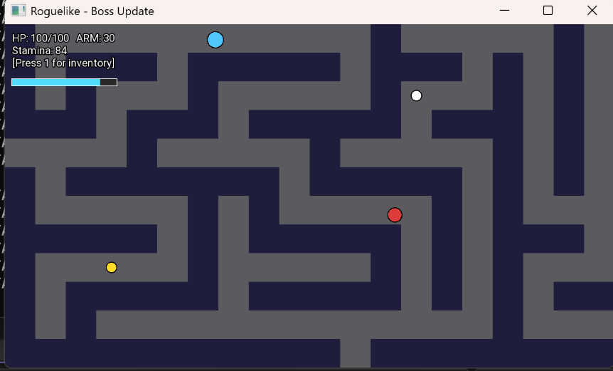
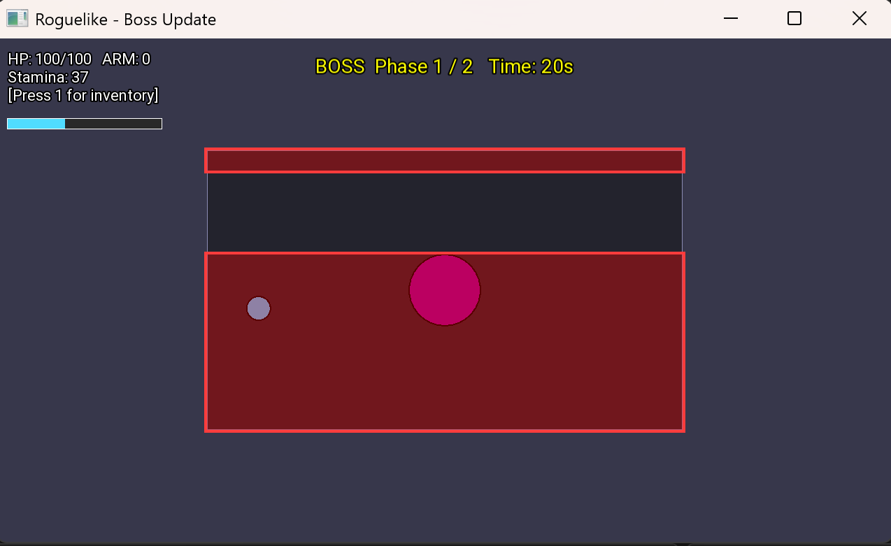
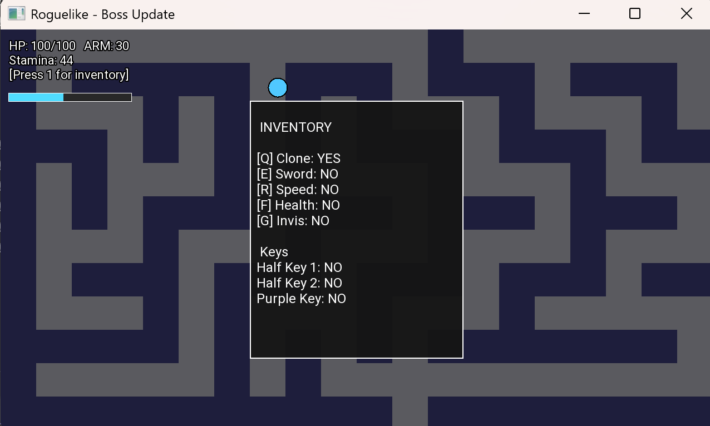

# Roguelike  Game (Мой Дипломный проект)

2D-игра в жанре рогалик, разработанная на C++ с использованием графической библиотеки SFML 2.5.1 и собственного игрового движка.

## Основные особенности
- **Собственный движок:** Компонентная архитектура (Entity-Component System), собственные системы рендера, ресурсов и логирования (выделен в отдельный DLL проект).
- **Процедурная генерация:** Лабиринт генерируется с помощью алгоритма DFS (Recursive Backtracker) и состоит из 6 связанных между собой комнат.
- **Умный ИИ:** Преследователь использует алгоритм поиска пути A* (A-star) для навигации по лабиринту.
- **Босс-файт:** Отдельная арена с боссом, имеющим 2 фазы. Механики уклонения от лазеров и пуль .
- **Инвентарь и предметы:** Механика невидимотси, клонирование, спринт с расходом стамины, лечение и специальные ключи.
- **Дискретная камера:** Перемещение камеры по секторам (блокам) лабиринта.

## Управление
- **WASD / Стрелки** — Движение
- **Shift** — Спринт (расходует стамину)
- **1** — Открыть/закрыть инвентарь
- **Q / E / R / F / G** — Использовать предметы (Клон, Меч, Ускорение, Лечение, Невидимость)
- **Enter** — Рестарт после смерти/победы

## Скриншоты
### Геймплей в лабиринте

### Битва с боссом

### Инвентарь

## Структура проекта
- `Engine/` — Исходный код игрового движка (собирается как DLL).
- `ArkanoidGame/` — Исходный код самой игры (игровые компоненты, логика босса, генерация лабиринта).
- `SFML/` — Локальная копия библиотеки SFML для сборки.

## Как собрать и запустить
1. Откройте файл `Game.sln` в Visual Studio (рекомендуется версия 2022).
2. Убедитесь, что в настройках проекта (C/C++ -> General -> Additional Include Directories) указан правильный путь к папке `SFML/include`.
3. Выберите конфигурацию `Debug` или `Release` и платформу `x64`.
4. Нажмите `Build -> Build Solution` (Собрать решение).
5. Запустите проект (F5). Убедитесь, что папка `Resources` находится рядом с исполняемым файлом.
